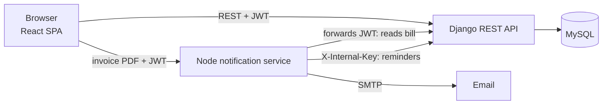
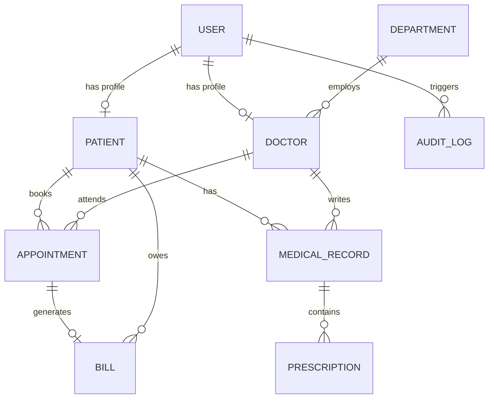

# Hospital Management System


A full-stack hospital management system with role-based access for **admins, doctors, receptionists and patients**. Patients book appointments from live free slots, doctors record diagnoses and prescriptions, and completing a visit raises a bill that can be paid online and downloaded as a PDF invoice.

**Live demo:** _add your Vercel link here_  
**API:** _add your Render/Railway link here_ (`/api/health/`)

| Layer | Technology |
| --- | --- |
| Frontend | React 18, Vite, React Router, Axios, Recharts |
| Core API | Python, Django 5, Django REST Framework, JWT (SimpleJWT) |
| Notification service | Node.js, Express, PDFKit, node-cron, Nodemailer |
| Database | MySQL 8 |
| DevOps | Docker, Docker Compose, GitHub Actions, Vercel, Render |

## Features

- **Role-based access control** (Admin, Doctor, Receptionist, Patient), enforced on the server for every endpoint and action
- **Appointment booking** from generated free slots, with reschedule and cancel
- **Double-booking prevention**: slot validation plus a row lock on the doctor inside a transaction, so two simultaneous requests cannot take the same slot
- **Medical records and prescriptions** (doctors can only write for patients they have seen)
- **Automated billing**: completing an appointment creates the consultation bill; payments by cash, card or UPI (simulated)
- **PDF invoices** generated by the Node service. It forwards the user's JWT to Django, so Django's permissions decide who may download what
- **Appointment reminder emails** (hourly cron job, dry-run logging when SMTP is not configured)
- **Audit log** of who viewed, created, edited or deleted patient and medical records
- **Admin dashboard** with 7-day charts for appointments and revenue
- Search, filters and pagination on every list; input validation with readable error messages
- Automated tests (16 API tests, Node PDF test) and a CI workflow

## Architecture



## Database (ER diagram)



## Demo accounts

Created automatically when `SEED_DEMO=true`:

| Role | Username | Password |
| --- | --- | --- |
| Admin | `admin` | `Admin@12345` |
| Doctor | `dr.sharma` | `Doctor@12345` |
| Receptionist | `reception` | `Reception@123` |
| Patient | `patient1` | `Patient@12345` |

Turn `SEED_DEMO` off (and `VITE_SHOW_DEMO=false`) for any deployment holding real data.

## Quick start with Docker

Requires Docker Desktop.

```bash
git clone https://github.com/YOUR-USERNAME/hospital-management-system.git
cd hospital-management-system
docker compose up --build
```

Then open:

- App: http://localhost:3000
- API: http://localhost:8000/api/health/ (Django admin at `/admin/`)
- Notification service: http://localhost:5000/health

Defaults work without a `.env` file. To customise passwords and keys: `cp .env.example .env`.

## Run without Docker (development)

**1. Backend** (Python 3.12). Quick start with SQLite, no MySQL needed:

```bash
cd backend-django
python -m venv .venv && source .venv/bin/activate     # Windows: .venv\Scripts\activate
pip install -r requirements.txt
export DEBUG=true DB_ENGINE=sqlite INTERNAL_API_KEY=dev-key   # Windows PowerShell: $env:DEBUG="true"; ...
python manage.py migrate
python manage.py seed_demo
python manage.py runserver 8000
```

To use MySQL instead, drop `DB_ENGINE` and set `DB_NAME`, `DB_USER`, `DB_PASSWORD`, `DB_HOST`, `DB_PORT` (or one `DATABASE_URL`).

**2. Notification service** (Node 18+):

```bash
cd notification-service
npm install
DJANGO_API_URL=http://localhost:8000 INTERNAL_API_KEY=dev-key npm start
```

**3. Frontend**:

```bash
cd frontend
npm install
cp .env.example .env
npm run dev          # http://localhost:5173
```

## Tests

```bash
cd backend-django && DEBUG=true DB_ENGINE=sqlite python manage.py test
cd notification-service && npm test
cd frontend && npm run build
```

## API overview

All routes are under `/api/` and need `Authorization: Bearer <access token>` except login, register and health.

| Endpoint | Purpose | Who |
| --- | --- | --- |
| `POST /auth/register/`, `/auth/login/`, `/auth/refresh/`, `GET /auth/me/` | Sign up (patients), JWT login, refresh, current user | public / any |
| `/patients/` | CRUD, search | staff write; doctors see own patients; patients see themselves |
| `/doctors/`, `/departments/` | CRUD, filter by department | admin write; all read |
| `GET /doctors/{id}/slots/?date=YYYY-MM-DD` | Free appointment slots | any |
| `/appointments/` | Book, reschedule (`PATCH`) | admin, receptionist, patient |
| `POST /appointments/{id}/cancel/` | Cancel | admin, receptionist, patient |
| `POST /appointments/{id}/complete/` | Complete and auto-create bill | admin, doctor |
| `/records/` | Diagnoses with nested prescriptions | doctor writes; patient reads own |
| `/bills/`, `POST /bills/{id}/pay/` | Billing and payment | staff create; patient pays own |
| `GET /dashboard/stats/` | Role-specific counts and charts | any |
| `GET /audit-logs/` | Who viewed or changed what | admin |
| `GET /api/invoices/{id}/pdf` (Node service) | PDF invoice | anyone allowed to read that bill |

## Project structure

```
hospital-management-system/
├── backend-django/          # Django REST API (accounts, patients, doctors, appointments, records, billing, core)
├── notification-service/    # Node + Express: PDF invoices, reminder emails
├── frontend/                # React + Vite single-page app
├── docs/DEPLOYMENT.md       # Step-by-step: live link with Vercel + Render + MySQL
├── docker-compose.yml       # MySQL + Django + Node + React
├── .github/workflows/ci.yml # Tests and build on every push
└── .env.example
```

## Deploy to get a live link

See **[docs/DEPLOYMENT.md](docs/DEPLOYMENT.md)**. Summary: React goes to Vercel; Django and Node run as Docker services on Render (or Railway); MySQL is a managed database.

## Resume bullets

- Built a full-stack Hospital Management System (React, Django REST Framework, Node.js, MySQL) with JWT authentication and role-based access control for four user roles.
- Implemented appointment scheduling with slot generation and transactional row locking to prevent double-booking under concurrent requests.
- Designed automated billing (invoice created when a visit is completed), PDF invoice generation, and a cron-based email reminder service in a separate Node.js microservice.
- Added audit logging for patient data access, an admin analytics dashboard, 16 API tests, Dockerised all services, and set up CI with GitHub Actions and cloud deployment (Vercel + Render).

## Possible next steps

Lab report uploads, real payment gateway (Razorpay or Stripe), SMS reminders, doctor leave and holiday calendar, real-time queue with WebSockets, and frontend tests.

## Licence

MIT. Free to use for learning and portfolio projects. This is a demo system and is not certified for handling real patient data.
